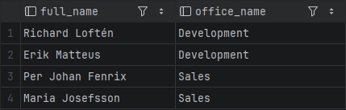
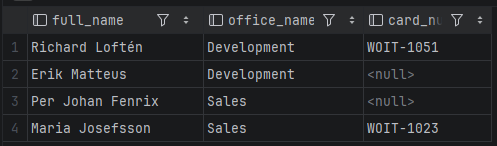
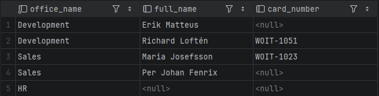
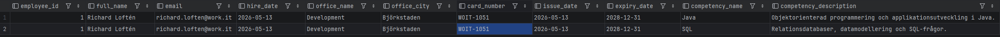
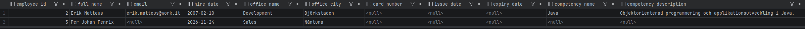
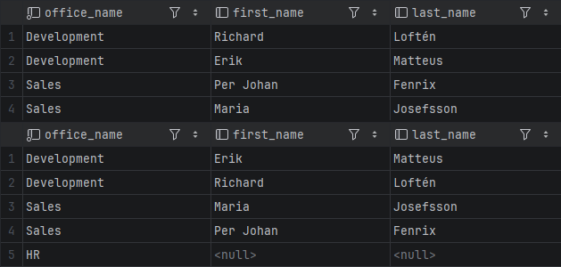
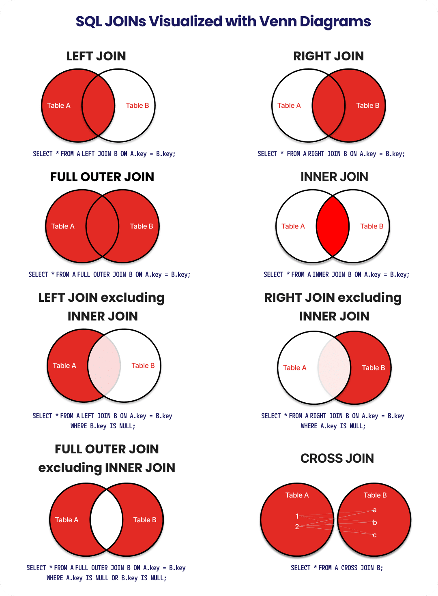
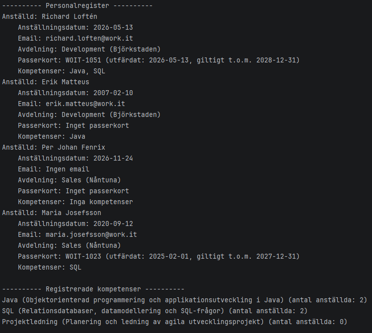

# Laboration 2: Databas Kursen
### Richards inlämning av laboration 2 (del 1)

### 1. Entiteter

Utifrån labbens beskrivning så finns det 3 olika objekt (Entiteter) för att få G

* **Avdelning (`department`)** - företagets olika avdelningar.
* **Anställd (`employee`)** - företagets personal
* **Passerkort (`access_card`)** - de passerkort som delas ut till vissa anställda.

#### VG Entiteter

* **Kompetens(`competency`)** - de kompetenser som företaget registrerar (Till exempel Java, SQL, med mera).
* **Anställd-Kompetens(`employee_competency`)** - kopplingstabell som hanterar en många-till-många-relation mellan anställda och kompetenser, i.e. en anställd ska kunna ha flera kompetenser och en kompetens kan ha flera anställda kopplade till sig. 


---

### 2. Attribut

Nedan redovisas (allt som krävs just för G) attribut, datatyper, nycklar samt regler för obligatoriska (`NOT NULL`) och unika (`UNIQUE`) värden för
respektive entitet:

* **Avdelning (`department`)**
    * `department_id` (`INT`, `PRIMARY KEY`, `AUTO_INCREMENT`) – en unik primärnyckel för avdelningen.
    * `office_name` (`VARCHAR(100)`, `NOT NULL`) - Avdelningens namn (Obligatoriskt)
    * `office_city` (`VARCHAR(100)`, `NOT NULL`) - Kontorsorten där avdelningen ligger (obligatoriskt)

* **Anställd (`employee`)**
    * `employee_id` (`INT`, `PRIMARY KEY`, `AUTO_INCREMENT`) – en unik primärnyckel för den anställde.
    * `first_name` (`VARCHAR(50)`, `NOT NULL`) – förnamn (obligatoriskt).
    * `last_name` (`VARCHAR(50)`, `NOT NULL`) – efternamn (obligatoriskt).
    * `email` (`VARCHAR(150)`, `UNIQUE`) – email address (unik om den anges, men tillåter `NULL` utifall att i företaget
      en anställd skulle inte ha en email).
    * `hire_date` (`DATE`, `NOT NULL`) – anställningsdatum (obligatoriskt).
    * `department_id` (`INT`, `NOT NULL`, `FOREIGN KEY`) – referens till den avdelning den anställde tillhör.

* **Passerkort (`access_card`)**
    * `employee_id` (`INT`, `PRIMARY KEY`, `FOREIGN KEY`) – delad primär- och främmande nyckel som kopplar kortet till
      exakt en anställd.
    * `card_number` (`VARCHAR(50)`, `NOT NULL`, `UNIQUE`) – unikt kortnummer (obligatoriskt).
    * `issue_date` (`DATE`, `NOT NULL`) – utfärdandedatum (obligatoriskt).
    * `expiry_date` (`DATE`, `NOT NULL`) – sista giltighetsdatum (obligatoriskt).

####  VG Attribut

* **Kompetens (`competency`)**
  * `competency_id` (`INT`, `PRIMARY KEY`, `AUTO_INCREMENT`) - En unik primärnyckel för kompetensen.
  * `name` (`VARCHAR(100)`, `NOT NULL`, `UNIQUE`) - kompetensens namn (Obligatoriskt och unikt).
  * `description` (`VARCHAR(255)`, `NOT NULL`) - beskrivning av kompetensen (Obligatoriskt).

* **Anställd-Kompetens (`employee_competency`)**
  * `employee_id` (`INT`, `PRIMARY KEY`, `FOREIGN KEY`) - referens till `employee(employee_id)`.
  * `competency_id` (`INT`, `PRIMARY KEY`, `FOREIGN KEY`) - referens till `competency(competency_id)`.

---

### 3. Relationer, kardinalitet och motiveringar

* **Avdelning – Anställd (`1` till `0..*` / En-till-många):**
    * **Beskrivning:** En avdelning kan ha noll eller flera anställda (valfri på anställd-sidan), medan varje anställd
      måste tillhöra exakt en avdelning (obligatorisk på avdelnings-sidan).
    * **Motivering:** Eftersom relationen är en-till-många placeras den främmande nyckeln `department_id` i tabellen
      `employee`. Villkoret `NOT NULL` säkerställer att ingen anställd kan registreras utan att kopplas till en
      befintlig avdelning.

* **Anställd – Passerkort (`1` till `0..1` / En-till-en):**
    * **Beskrivning:** En anställd kan ha högst ett passerkort, men behöver inte ha något (valfri). Varje registrerat
      passerkort tillhör exakt en anställd (obligatorisk).
    * **Motivering:** Genom att låta `employee_id` i `access_card` fungera som både `PRIMARY KEY` och `FOREIGN KEY`
      (delad primärnyckel) blir kolumnen automatiskt både `NOT NULL` och `UNIQUE`. Det garanterar på databasnivå att
      varje passerkort hör till en giltig anställd och förhindrar att samma anställd tilldelas flera passerkort,
      samtidigt som en anställd kan sakna rad i `access_card`.


#### VG Relation et cetera
- **Anställd – Kompetens (`0..*` till `0..*` / Många-till-många – VG):**
  - **Beskrivning:** En anställd kan ha noll eller flera kompetenser och samma kompetens kan finnas hos noll eller flera anställda. En kompetens kan även registreras innan någon anställd har den.
  - **Motivering:** En många-till-många-relation löses i en relationsdatabas med kopplingstabellen `employee_competency`. Genom att använda en sammansatt primärnyckel (`PRIMARY KEY (employee_id, competency_id)`) säkerställs att samma kompetens inte kan kopplas till samma anställd flera gånger.
---

#### Motivering för Email i anställd

I tabellen för anställda resonerade jag att en anställd behöver inte direkt ha en email då inte alla företag har alla en
email (VÄLDIGT SÄLLSYNT) plus att i krav specen fanns det inte med att det behövdes finnas bara måste vara unikt.

---

### 4. ER-Diagram


## SQL-queries och resultat

### G1. Anställda med avdelning (`INNER JOIN`)
```mysql
SELECT concat(e.first_name, ' ', e.last_name ) AS full_name, d.office_name
FROM employee AS e
        INNER JOIN department AS d ON e.department_id = d.department_id;
```


**Förklaring:** Frågan hämtar alla anställda tillsammans med namnet på den avdelning de tillhör. Eftersom `INNER JOIN` används visas enbart rader där det finns en matchning i båda tabellerna. Avdelningen *HR* (som saknar anställda) kommer därför inte med i resultatet.

### G2. Avdelningar med anställda (`LEFT JOIN`)
```mysql
SELECT d.office_name, concat(e.first_name, ' ', e.last_name ) AS full_name
FROM department AS d
         LEFT JOIN employee AS e ON e.department_id = d.department_id;
```


**Förklaring:** Här utgår frågan från tabellen `department` med en `LEFT JOIN` mot `employee`. Detta gör att alla avdelningar visas i resultatet, även de som saknar anställda. Avdelningen *HR* visas `NULL` i kolumnen för den anställdes fulla namn.

### VG1. Anställda med avdelning och passerkort
```mysql
SELECT CONCAT(e.first_name, ' ', e.last_name) AS full_name,
       d.office_name,
       ac.card_number
FROM employee AS e
    INNER JOIN department AS d on e.department_id = d.department_id
    LEFT JOIN access_card ac on e.employee_id = ac.employee_id;
```


**Förklaring:** Frågan hämtar alla anställda och deras avdelning med `INNER JOIN`, och använder `LEFT JOIN` mot `access_card`. Det gör att samtliga anställda finns med i resultatet och för Erik och Per Johan som saknar passerkort visas `NULL` i kolumnen `card_number`.

### VG2. Avdelningar med anställda och passerkort
```mysql
SELECT d.office_name,
       CONCAT(e.first_name, ' ', e.last_name) AS full_name,
       ac.card_number
FROM department AS d
         LEFT JOIN employee AS e on e.department_id = d.department_id
         LEFT JOIN access_card ac on e.employee_id = ac.employee_id;
```


**Förklaring:** Genom att utgå från `department` och kedja två `LEFT JOIN` behålls både den tomma avdelningen *HR* (med `NULL` för både anställd och kortnummer) och anställda som saknar passerkort (Erik och Per Johan).

### VG3. En anställds samlade uppgifter & kontroll av valfria kopplingar
```mysql
SELECT
    e.employee_id,
    CONCAT(e.first_name, ' ',e.last_name)
                  AS full_name,
    e.email,
    e.hire_date,
    d.office_name,
    d.office_city,
    ac.card_number,
    ac.issue_date,
    ac.expiry_date,
    c.name AS competency_name,
    c.description AS competency_description
FROM employee AS e
         LEFT JOIN department AS d ON e.department_id = d.department_id
         LEFT JOIN access_card AS ac ON e.employee_id = ac.employee_id
         LEFT JOIN employee_competency AS ec ON e.employee_id = ec.employee_id
         LEFT JOIN competency AS c ON ec.competency_id = c.competency_id
WHERE e.employee_id = 1;
```



**Förklaring:**
- **Varför Richard (`employee_id = 1`) ger flera rader:** Richard har två registrerade kompetenser (`Java` och `SQL`). Eftersom relationen från `employee` till `employee_competency` är en-till-många returnerar SQL en rad per matchande kompetens, vilket gör att uppgifterna om Richard, hans avdelning och hans passerkort upprepas på två rader.
- **Kontroll av Erik (`employee_id = 2`, utan passerkort) och Per Johan (`employee_id = 3`, utan passerkort och kompetenser):** Eftersom `LEFT JOIN` används bevaras raden från vänstertabellen `employee` även när det saknas matchning i `access_card` eller i `employee_competency`/`competency`. De saknade kolumnerna fylls då med `NULL` i stället för att den anställde filtreras bort.

### VG4. Jämförelse mellan `INNER JOIN` och `LEFT JOIN`
```mysql
# 1. INNER JOIN
SELECT d.office_name, e.first_name, e.last_name
FROM department AS d
         INNER JOIN employee AS e ON d.department_id = e.department_id;

# 2. LEFT JOIN
SELECT d.office_name, e.first_name, e.last_name
FROM department AS d
         LEFT JOIN employee AS e ON d.department_id = e.department_id;
```


**Förklaring:**
- **Vilken avdelning försvinner med `INNER JOIN`?** Avdelningen *HR* försvinner eftersom den inte har några matchande rader i tabellen `employee`.
- **Varför finns den kvar med `LEFT JOIN`?** `LEFT JOIN` returnerar samtliga rader från den vänstra tabellen (`department`) oavsett om det finns någon matchande rad i den högra tabellen (`employee`).
- **Vad visas i kolumnerna för den anställde på den raden?** Värdet `NULL` visas i både `first_name` och `last_name`.


Ett bra sätt att visualisera detta är med detta venn diagram


---

## Java-applikation

### Motsvarighet till datamodellen

Databasens tabeller motsvaras av tre modellklasser i paketet `lab2`:

* **`Department`** motsvarar tabellen `department` med fälten `departmentId`, `officeName` och `officeCity`.
* **`Employee`** motsvarar tabellen `employee` med fälten `employeeId`, `firstName`, `lastName`, `email`, `hireDate` samt referenser till avdelning och eventuellt passerkort.
* **`AccessCard`** motsvarar tabellen `access_card` med fälten `cardNumber`, `issueDate` och `expiryDate`.
* **`Competency`** motsvarar tabellen `competency` med fälten `competencyId`, `name` och `description`.


### Representation av relationer och valfria värden

Kopplingarna i Java är implementerade enkelriktat från `Employee` utåt, vilket innebär att varken `Department`, `AccessCard` eller `Competency` håller någon referens tillbaka till `Employee`:

- **Anställd – Avdelning (`1`):** `Employee` har ett obligatoriskt fält `private final Department department` som valideras med `Objects.requireNonNull(...)` i konstruktorn, vilket speglar `department_id NOT NULL` i databasen.
- **Anställd – Passerkort (`0..1`):** `Employee` har ett valfritt fält `private AccessCard accessCard` som sätts via `setAccessCard(...)`. Gettern `getAccessCard()` returnerar `Optional<AccessCard>` för att tydligt hantera att en anställd kan sakna passerkort utan risk för `NullPointerException`.
- **Valfri e-postadress:** Eftersom `email` i databasen tillåter `NULL` så kan den i databasen returnera null; därav returnerar även `getEmail()` en `Optional<String>`.
- **Anställd – Kompetens (`0..*` – VG5):** `Employee` lagrar sina kompetenser i ett `Set<Competency>` (`LinkedHashSet`). Genom att implementera `equals` och `hashCode` i `Competency` förhindras dubbletter av samma kompetens hos en anställd, vilket motsvarar den sammansatta primärnyckeln i `employee_competency`. Varje `Competency`-instans (t.ex. `java` och `sql`) skapas en gång i `Main` och delas mellan flera `Employee`-objekt utan att dupliceras, och kompetensen `projektledning` skapas som ett fristående objekt utan att kopplas till någon anställd.

### Utskrift från programmet



### Hur programmet startas

1. Klona repot och öppna mappen `ITHS-Lab2-Database` i IntelliJ IDEA (eller annan Java-IDE).
2. Navigera till klassen `Main` i paketet `tech.larssonivarsson.richard.lab2` (`src/main/java/tech/larssonivarsson/richard/lab2/Main.java`).
3. Kör `main`-metoden direkt i IDE:n (eller via terminalen med `./mvnw compile exec:java` / `javac` och `java` beroende på projektets byggverktyg).
