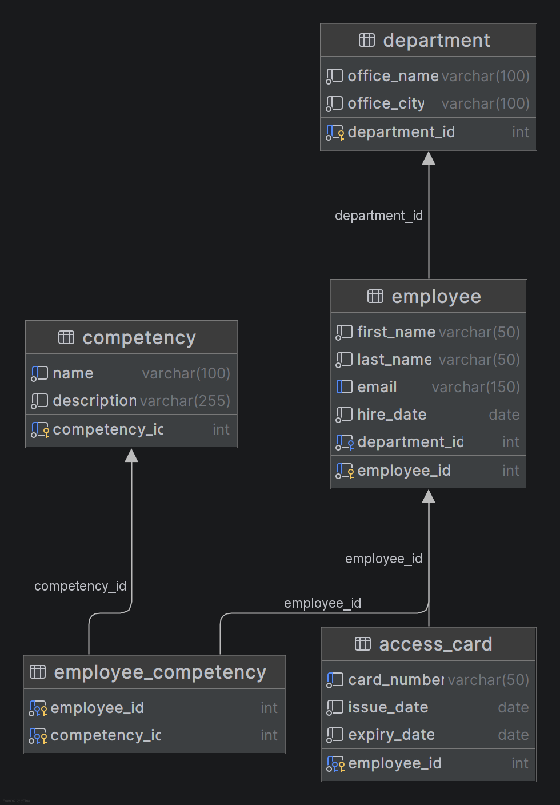
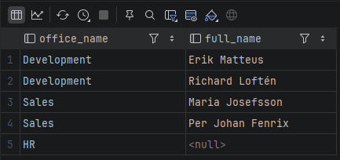

# Laboration 2: Databas Kursen

### 1. Entiteter

Utifrån labbens beskrivning så finns det 3 olika objekt (Entiteter) för att få G

* **Avdelning (`department`)** - företagets olika avdelningar.
* **Anställd (`employee`)** - företagets personal
* **Passerkort (`access_card`)** - de passerkort som delas ut till vissa anställda.

---

### 2. Attribut

Nedan redovisas (allt som krävs just för G) attribut, datatyper, nycklar samt regler för obligatoriska (`NOT NULL`) och unika (`UNIQUE`) värden för
respektive entitet:

* **Avdelning (`department`)**
    * `department_id` (`INT`, `PRIMARY KEY`, `AUTO_INCREMENT`) – en unik primärnyckel för avdelningen.
    * `office_name` (`VARCHAR(100)`, `NOT NULL`) - Avdelningens namn (Obligatoriskt)
    * `office_city` (`VARCHAR(100)`, `NOT NULL`) - Kontorsorten där avdelningen ligger (obligatoriskt)

* **Anställd (`employee`)**
    * `employee_id` (`INT`, `PRIMARY KEY`, `AUTO_INCREMENT`) – en unik primärnyckel för den anställde.
    * `first_name` (`VARCHAR(50)`, `NOT NULL`) – förnamn (obligatoriskt).
    * `last_name` (`VARCHAR(50)`, `NOT NULL`) – efternamn (obligatoriskt).
    * `email` (`VARCHAR(150)`, `UNIQUE`) – email address (unik om den anges, men tillåter `NULL` utifall att i företaget
      en anställd skulle inte ha en email).
    * `hire_date` (`DATE`, `NOT NULL`) – anställningsdatum (obligatoriskt).
    * `department_id` (`INT`, `NOT NULL`, `FOREIGN KEY`) – referens till den avdelning den anställde tillhör.

* **Passerkort (`access_card`)**
    * `employee_id` (`INT`, `PRIMARY KEY`, `FOREIGN KEY`) – delad primär- och främmande nyckel som kopplar kortet till
      exakt en anställd.
    * `card_number` (`VARCHAR(50)`, `NOT NULL`, `UNIQUE`) – unikt kortnummer (obligatoriskt).
    * `issue_date` (`DATE`, `NOT NULL`) – utfärdandedatum (obligatoriskt).
    * `expiry_date` (`DATE`, `NOT NULL`) – sista giltighetsdatum (obligatoriskt).

---

### 3. Relationer, kardinalitet och motiveringar

* **Avdelning – Anställd (`1` till `0..*` / En-till-många):**
    * **Beskrivning:** En avdelning kan ha noll eller flera anställda (valfri på anställd-sidan), medan varje anställd
      måste tillhöra exakt en avdelning (obligatorisk på avdelnings-sidan).
    * **Motivering:** Eftersom relationen är en-till-många placeras den främmande nyckeln `department_id` i tabellen
      `employee`. Villkoret `NOT NULL` säkerställer att ingen anställd kan registreras utan att kopplas till en
      befintlig avdelning.

* **Anställd – Passerkort (`1` till `0..1` / En-till-en):**
    * **Beskrivning:** En anställd kan ha högst ett passerkort, men behöver inte ha något (valfri). Varje registrerat
      passerkort tillhör exakt en anställd (obligatorisk).
    * **Motivering:** Genom att låta `employee_id` i `access_card` fungera som både `PRIMARY KEY` och `FOREIGN KEY`
      (delad primärnyckel) blir kolumnen automatiskt både `NOT NULL` och `UNIQUE`. Det garanterar på databasnivå att
      varje passerkort hör till en giltig anställd och förhindrar att samma anställd tilldelas flera passerkort,
      samtidigt som en anställd kan sakna rad i `access_card`.

---

#### Motivering för Email i anställd

I tabellen för anställda resonerade jag att en anställd behöver inte direkt ha en email då inte alla företag har alla en
email (VÄLDIGT SÄLLSYNT) plus att i krav specen fanns det inte med att det behövdes finnas bara måste vara unikt.

---

### 4. ER-Diagram



## SQL-queries och resultat

### G1. Anställda med avdelning (`INNER JOIN`)
```mysql
SELECT concat(e.first_name, ' ', e.last_name ) AS full_name, d.office_name
FROM employee AS e
        INNER JOIN department AS d ON e.department_id = d.department_id;
```


**Förklaring:** Frågan hämtar alla anställda tillsammans med namnet på den avdelning de tillhör. Eftersom `INNER JOIN` används visas enbart rader där det finns en matchning i båda tabellerna. Avdelningen *HR* (som saknar anställda) kommer därför inte med i resultatet.

### G2. Avdelningar med anställda (`LEFT JOIN`)
```mysql
SELECT d.office_name, concat(e.first_name, ' ', e.last_name ) AS full_name
FROM department AS d
         LEFT JOIN employee AS e ON e.department_id = d.department_id;
```


**Förklaring:** Här utgår frågan från tabellen `department` med en `LEFT JOIN` mot `employee`. Detta gör att alla avdelningar visas i resultatet, även de som saknar anställda. Avdelningen *HR* visas `NULL` i kolumnen för den anställdes fulla namn.

## Java-applikation

### Motsvarighet till datamodellen

Databasens tabeller motsvaras av tre modellklasser i paketet `lab2`:

* **`Department`** motsvarar tabellen `department` med fälten `departmentId`, `officeName` och `officeCity`.
* **`Employee`** motsvarar tabellen `employee` med fälten `employeeId`, `firstName`, `lastName`, `email`, `hireDate` samt referenser till avdelning och eventuellt passerkort.
* **`AccessCard`** motsvarar tabellen `access_card` med fälten `cardNumber`, `issueDate` och `expiryDate`.

### Representation av relationer och valfria värden

Kopplingarna i Java är implementerade enkelriktat från `Employee` utåt, vilket innebär att varken `Department` eller `AccessCard` håller någon referens tillbaka till `Employee`:

* **Anställd – Avdelning (`1`):** `Employee` har ett obligatoriskt fält `private final Department department` som valideras med `Objects.requireNonNull(...)` i konstruktorn, vilket speglar `department_id NOT NULL` i databasen.
* **Anställd – Passerkort (`0..1`):** `Employee` har ett valfritt fält `private AccessCard accessCard` som sätts via `setAccessCard(...)`. Gettern `getAccessCard()` returnerar `Optional<AccessCard>` för att tydligt hantera att en anställd kan sakna passerkort utan risk för `NullPointerException`.
* **Valfri e-postadress:** Eftersom `email` i databasen tillåter `NULL` så kan den i databasen returnera null där av det så returnerar även `getEmail()` en `Optional<String>`.

### Utskrift från programmet


### Hur programmet startas

1. Klona repot och öppna mappen `ITHS-Lab2-Database` i IntelliJ IDEA (eller annan Java-IDE).
2. Navigera till klassen `Main` i paketet `tech.larssonivarsson.richard.lab2` (`src/main/java/tech/larssonivarsson/richard/lab2/Main.java`).
3. Kör `main`-metoden direkt i IDE:n (eller via terminalen med `./mvnw compile exec:java` / `javac` och `java` beroende på projektets byggverktyg).
