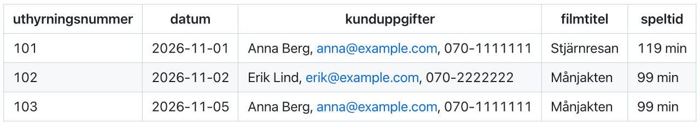

# Richards inlämning av laboration 2 (del 2)

## Underlag

Det underlag vi har fått visas i bilden under.

Filmuthyrningen lagrar sina uthyrningar i ett enda kalkylblad där all information finns samlad i samma tabell.

### Problem som uppkommer i ursprungsdatan
* **Sammansatta värden i en cell:** Kolumnen `kunduppgifter` innehåller tre separata uppgifter (namn, email-address, och telefonnummer) i samma cell, vilket gör det svårt att urskilja data sedan gör det också svårt att söka, sortera eller validera enskilda fält.
* **Upprepad fakta (redundans):** Kunduppgifterna för Anna Berg är upprepade på de följande raderna som innehåller uthyrningsnumret också `101` och `102`.
* **Ändrings-, tilläggs- och borttagningsanomalier:** Om nu Anna skulle byta hennes telefonnummer måste ändringen göras på flera rader (annars leder detta till inkonsekvent data (vilket är något man inte vill ha)). Dessutom går det inte att registrera en ny kund eller en ny film i systemet förrän en uthyrning sker, och om en uthyrningsrad raderas försvinner även informationen om kunden eller filmen.

---

## Normalisering steg för steg

### Steg 1: Dela upp celler som innehåller flera separata uppgifter
Första steget är att se till att varje cell endast innehåller ett enskilt (Atomärt) värde. Kolumnen `kunduppgifter` delas därför itu, då blir det tre separata kolumner: `kundnamn`, `email`, och `telefonnummer`.

|uthyrningsnummer (PK)  |datum  |kundnamn   |email   |telefonnummer   |filmtitel   |speltid   |
|---|---|---|---|---|---|---|
|101   |2026-11-01   |Anna Berg   |anna@example.com   |070-1111111   |Stjärnresan   |   119 min|
|102|2026-11-02   |Erik Lind   |erik@example.com   |070-2222222   |   Månjakten| 99 min   |
|103   |2026-11-05   |Anna Berg   |anna@example.com   |070-1111111   |   Månjakten|99 min |

#### Motivering och nyckelval:
* **Vad som löses:** Varje uppgift ligger nu i en egen kolumn, vilket gör det möjligt att filtrera och söka på exempelvis telefonnummer eller email-adress separat. All ursprunglig data är resterande.
* **Vad som kvarstår:** Samma fakta upprepas fortfarande på flera rader. Både Annas kunduppgifter och uppgifterna om filmen Månjakten är duplicerade, vilket innebär att en ändring av telefonnummer eller speltid fortfarande kräver uppdateringar på flera ställen.
---

### Steg 2: Bryt ut kunduppgifter till en egen tabell
Uppgifterna `kundnamn`, `email`, `telefonnummer` beskriver kunder och inte den själva uthyrningstillfället. Eftersom samma kund kan hyra flera film flera gånger bryts kunduppgifterna ut till en separat tabell (`kund`) och kopplas tillbaka till uthyrning via en främmande nyckel (`kund_id`)

#### Tabell: `kund`
|kund_id (PK)   |kundnamn   |email (UNIQUE)   |telefonnummer   |
|---|---|---|---|
|   1|   Anna Berg|   anna@example.com|   070-1111111|
|   2|   Erik Lind|   erik@example.com|   070-2222222|

#### Tabell: `uthyrning` (efter steg 2)

|uthyrningsnummer (PK)   |datum   |kund_id (FK)   |filmtitel   |speltid   |
|---|---|---|---|---|
|   101|  2026-11-01  |   1|   Stjärnresan|   119 min|
|   102|  2026-11-02 |   2|   Månjakten|   99 min|
|   103|  2026-11-05  |   1|   Månjakten|   99 min|

#### Motivering och nyckelval:
* **Vad som löses:** Varje uppgift ligger nu i en egen kolumn, vilket gör det möjligt att filtrera och söka på exempelvis email-adress eller telefonnummer separat. All ursprunglig data finns kvar.
* **Vad som kvarstår:** Samma fakta upprepas fortfarande på flera rader. Både Annas kunduppgifter och uppgifterna om filmen *Månjakten* är duplicerade, vilket innebär att en ändring av telefonnummer eller speltid fortfarande kräver uppdateringar på flera ställen.
---
### Steg 3: Bryt ut filmuppgifter till en egen tabell
Kolumnerna `filmtitel` och `speltid` hör ihop och beskriver själva filmen. Eftersom samma film kan förekomma i flera uthyrningar flyttas filmuppgifterna till en egen tabell (`film`) och ersätts i `uthyrning` av den främmande nyckeln `film_id`.

#### Tabell: `film`
|film_id (PK)   |filmtitel (UNIQUE)   |speltid   |
|---|---|---|
|   1|   Stjärnresan|   119 min|
|   2|   Månjakten|   99 min|

#### Tabell: `uthyrning` (Efter steg 3)
| uthyrningsnummer (PK)  | datum  | kund_id (FK)  | film_id (FK)  |
|---|---|---|---|
|   101|   2026-11-01|   1|   1|
|   102|   2026-11-02|   2|   2|
|   103|   2026-11-05|   1|   2|

#### Motivering och nyckelval:
- **Val av primärnyckel:** Trots att filmtiteln identifierar filmen i övningen införs ett automatiskt genererat `film_id` som primärnyckel i `film` (samtidigt som `filmtitel` kan behålla `UNIQUE`). Ett numeriskt ID är kompakt att lagra som främmande nyckel i `uthyrning` och påverkas inte om en filmtitel skulle korrigeras i efterhand.
- **Vad som löses:** Varje films titel och speltid lagras endast en gång. Nu kan både kunder och filmer läggas in i databasen oberoende av om någon uthyrning har genomförts ännu, och ingen fakta upprepas på flera ställen.
---

## Färdig databasstruktur
Efter uppdelningen består databasen av tre normaliserade tabeller där all ursprunglig information finns bevarad utan redundans.

### 1. `kund`
| kund_id (PK) | kundnamn | email (UNIQUE) | telefonnummer |
|--- |--- |--- |--- |
| 1 | Anna Berg | anna@example.com | 070-1111111 |
| 2 | Erik Lind | erik@example.com | 070-2222222 |

### 2. `film`
| film_id (PK) | filmtitel (UNIQUE) | speltid |
|--- |--- |--- |
| 1 | Stjärnresan | 119 min |
| 2 | Månjakten | 99 min |

### 3. `uthyrning`
| uthyrningsnummer (PK) | datum | kund_id (FK) | film_id (FK) |
|--- |--- |--- |--- |
| 101 | 2026-11-01 | 1 | 1 |
| 102 | 2026-11-02 | 2 | 2 |
| 103 | 2026-11-05 | 1 | 2 |

---

### Sammanställning av nycklar (PK och FK)

* **Tabellen `kund`:**
  * **Primärnyckel (PK):** `kund_id` (unikt, automatiskt genererat ID för varje kund).
  * **Främmande nycklar (FK):** Inga.
* **Tabellen `film`:**
  * **Primärnyckel (PK):** `film_id` (unikt, automatiskt genererat ID för varje film).
  * **Främmande nycklar (FK):** Inga.
* **Tabellen `uthyrning`:**
  * **Primärnyckel (PK):** `uthyrningsnummer` (befintligt unikt nummer för varje uthyrning, t.ex. 101, 102, 103).
  * **Främmande nyckel (FK 1):** `kund_id` hänvisar till `kund(kund_id)`.
  * **Främmande nyckel (FK 2):** `film_id` hänvisar till `film(film_id)`.

---

### Relationer mellan tabellerna

* **`kund`–`uthyrning` (`1` till `0..*` / En-till-många):**
  * En kund kan göra noll eller flera uthyrningar över tid, medan varje enskild uthyrning gäller exakt en kund (`kund_id` är obligatorisk i `uthyrning`).
* **`film`–`uthyrning` (`1` till `0..*` / En-till-många):**
  * En film kan förekomma i noll eller flera uthyrningar, medan varje enskild uthyrning avser exakt en film (`film_id` är obligatorisk i `uthyrning`).
* **Sammantagen koppling (`kund`–`film`):**
  * Genom att `uthyrning` har främmande nycklar mot både `kund` och `film` fungerar `uthyrning` även som en kopplingstabell mellan kunder och filmer (många-till-många över tid), där samma kund kan hyra samma film vid olika datum eftersom varje uthyrning har ett eget `uthyrningsnummer`.